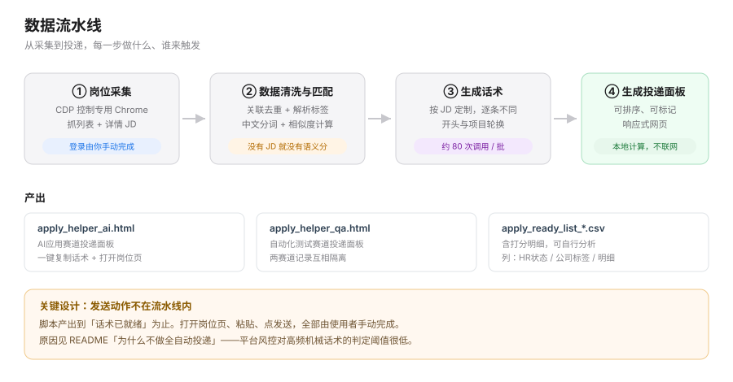
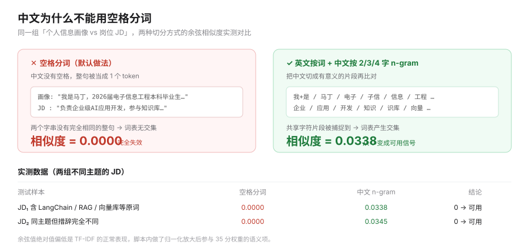
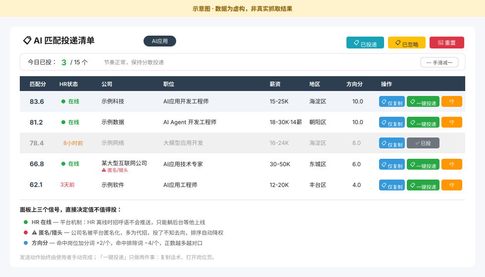

# AI 求职助手（BOSS直聘）

本地匹配排序 + 大模型生成差异化招呼语 + 手动投递面板。

> ⚠️ **本项目不自动投递、不模拟点击发送、不批量群发消息。**
> 脚本产出到「话术已就绪」为止，打开岗位页、粘贴、点发送全部由使用者手动完成。



---

## 这个项目解决什么问题

手动投递的流程是：在一堆岗位里翻 → 逐个判断自己和岗位搭不搭 → 复制一段差不多的招呼语 → 粘贴发送。岗位越多，越容易退化成「看标题顺眼就投」，招呼语也越来越像群发。

这个项目把可自动化的部分抽出来：

| 环节 | 谁来做 |
|---|---|
| 岗位采集（含 JD 正文） | 脚本，通过 CDP 控制已登录的浏览器 |
| 匹配打分、排序、分赛道 | 脚本，本地计算 |
| 生成差异化招呼语 | 脚本，调大模型 API |
| **打开岗位、粘贴、发送** | **使用者本人** |

产出是一个 HTML 面板：按匹配分排序、每条附一段针对该岗位 JD 生成的招呼语，点「一键投递」只做两件事——复制话术、打开岗位页。投递节奏、每日上限都靠人自己把握。

---

## 为什么不做全自动投递

这是刻意的设计取舍，不是没做完。

求职平台的账号风控对「短时间高频主动打招呼 + 机械重复话术 + 页面零停留」这组特征的判定阈值很低，一旦触发轻则功能限制、重则封号，且申诉成本极高。而求职者的账号本身就是最有价值的资产——**用主账号去赌一个自动发送脚本不被识别，风险收益比不成立**。

所以本项目只接管「筛选」和「准备」，把「发送」留给人。面板顶部带一个每日投递计数提示，帮助使用者把节奏控制在合理范围。

---

## 采集端从哪来

**本仓库不含爬虫，只做「拿到数据之后」的部分。**

| 数据 | 采集程序 | 位置 |
|---|---|---|
| BOSS 直聘 | `boss_cdp_raw.py` | `boss-zhipin-scraper` 项目（另一个仓库） |
| 猎聘 | `liepin_cdp.py` | 同上，见「已知限制」 |

本仓库的脚本只读它们输出的 JSON（默认在 `~/.boss-zhipin-scraper/job-result/`），
不发起任何采集请求。

**为什么不并进来**：采集涉及登录态维持、翻页节奏、风控规避、详情页间隔控制
（每抓一个要等 10~25 秒），是独立的一摊工程。和匹配/话术/面板混在一起，
两边都会变难维护——而且采集器要单独演进，不该被投递逻辑的改动牵连。

所以第一次用需要先跑采集器拿到 JSON，再跑本仓库的脚本。**单独 clone
本仓库跑不起来**，这是设计上的取舍，不是疏漏。

---

## 核心实现

### 1. 岗位采集

通过 Chrome DevTools Protocol 连接一个**专用 Chrome 实例**（独立 profile，不碰日常浏览器），抓取岗位列表与详情页 JD 正文。登录由使用者在浏览器里手动完成，脚本只复用这个已登录的会话。

列表数据和详情数据分别落在两个文件里：

```
boss_jobs_*.json     列表：标题/薪资/地区/公司/HR活跃状态
boss_details_*.json  详情：JD 正文、技能标签
```

### 2. 数据清洗与匹配

两个文件必须先在本地整合，才能进入打分环节：

- **关联**：按 `job_id` 把详情文件的 JD 正文并回列表数据
- **去重**：跨多次抓取按 `job_id` 去重，保留最新一条
- **解析**：从 `tags` 里拆出经验要求、学历要求；从 `salary` 解析薪资区间（兼容 `15-25K`、`元/月`、`元/天` 三种写法）
- **匹配**：对 JD 正文做中文分词与 TF-IDF 向量化，计算与个人画像的余弦相似度

> **关联这一步不做，语义匹配就拿不到 JD 正文**，35 分权重的语义项只能退回兜底分——项目早期版本正是踩了这个坑。

#### 关于中文分词

TF-IDF + 余弦相似度本身没问题，问题出在分词：`TfidfVectorizer` 默认按空格切词，而中文没有空格，**整句话会被当成一个 token**。结果是两段中文只要不是逐字相同，词表就没有交集，相似度恒为 0——等于整个匹配引擎是半瞎的。



解决办法是自定义 analyzer：英文按词切，中文按 2/3/4 字 n-gram 切（中文双字词占比高，n-gram 能捕捉到「向量」「检索」「知识库」这类有效片段，且不需要引入分词词典依赖）。

### 3. 打分排序

清洗后的数据进入八维加权打分（见下方[打分维度](#打分维度)），按赛道分池、组内排序。每条岗位输出可解释的明细，方便判断某一项为什么高或低：

```
技术栈30.0｜经验6.8｜学历10｜薪资10｜语义13.0｜方向10.0｜公司0｜活跃5.0
```

### 3.5 硬排除：命中就不投

打分只能排序，没法把「根本不该投」的岗位清掉——一个写着「985/211 背景」
的岗位即使匹配分 90 分，简历这一关也过不了。所以另设一层硬排除
（`_GLOBAL_EXCLUDE` 7 类 + 每个赛道自己的标题规则），命中即不进入面板：

| 规则名 | 匹配位置 | 判据 |
|---|---|---|
| `经验要求 5 年以上` | JD | 5 年以上（3 年以上只降权，有些岗写 3 年但接受优秀应届） |
| `只要 27 届` | 标题 + JD | 27届 / 2027届 / 毕业时间：2027（本人 2026-06 毕业） |
| `院校门槛 985/211` | 标题 + JD | 985 / 211 / 双一流 |
| `明说外包/驻场` | 标题 + JD | 驻场、外派、人力外包、岗位外包、第三方签约、派遣制 |
| `标题含外包` | **仅标题** | 标题里出现「外包」直接判死 |
| `外包/派遣公司` | 公司名 | 外企德科、柯莱特、中软国际、软通动力等确实的派遣商 |
| `PHP 专属框架` | JD | Laravel / Lumen / Yaf / ThinkPHP（出现即说明必须会 PHP） |
| `exclude_title_pattern` | **仅标题** | 讲师、培训、营销、硬件、嵌入式、车载、算法研究 |
| `exclude_title_extra` | **仅标题** | PHP、算法工程师、机器视觉、计算机视觉、深度学习 |

**设计原则：只在有硬证据时排除，不因为「提到了某个语言」就排除。**

> **这条原则是被误杀逼出来的。** 最初打算按「不会的语言」过滤，实测会把
> 一大批岗位错杀：
> - FunPlus 写「熟悉 Python/Go/Java/C#/C++ 中**至少一种**」——会 Python 就够
> - 纬致科技写「至少掌握一种：Python/Java」——同理
>
> 所以改成只在「核心技术栈明显不对口」时才剔，判据是**出现专属框架名**
> （Laravel 说明必须会 PHP），而不是出现语言名。

**三个防止误伤的设计：**

1. **985/211 不能裸匹配。** 写成 `985|211` 会撞上岗位编号（`J211`）、
   薪资数字（`9850`）、电话号。必须带上下文：`985/211` 连写、
   `985及以上`、`985院校`、`985工程` 这类说法。
2. **写「优先」的放行。** `AutoAgents.ai` 写「（985、211、QS Top 100
   院校背景**优先**）」，那是加分项不是门槛。`_degree_is_pref()` 检查
   985/211 提法后 24 字内有没有「优先」，有则保留。
3. **写「非外包」的放行。** `_all_outsource_mentions_negated()` 判断
   外包/外派/驻场的所有提法是否都带否定词（非/不/无需/免），是则保留。
4. **「26 27届」这类兼容写法的放行。** `_NEXT_COHORT_ALLOW` 匹配
   `26 27届`、`26届`、`应届及往届`、`不限届别`，命中则不按 27 届剔除。

> **踩坑记录**：裸词「外包」一开始漏了。易车「智能体研发工程师-外包」、
> 集联软件「外包能源国企 智能体开发工程师」——标题里有，JD 正文没有，
> 而原规则只匹配「外包岗」「外包公司」这类组合词。补上后改为
> **只在标题里匹配裸词**，避免误伤 JD 中「外包团队协作经验」这类普通表述。

### 4. 生成话术

#### 4.1 判断由代码做，模型只负责表达

早期把规则写进 prompt 交给模型判断，实测三类规则全部失效：

| 规则 | 写进 prompt 后的实测结果 | 改为代码控制的做法 |
|---|---|---|
| 开头要多样化 | 8 次生成全部固定用同一种开头（8/8 相同） | 轮换多种开头，prompt 只要求「原样照抄指定这句」 |
| JD 提到开源才附仓库链接 | 该附的不附，模型直接忽略 | 正则判断 JD 是否在索取作品集，命中才在结尾插入 |
| 讲哪段经历 | 默认永远讲同一段，一批 10 条话术正文完全一致 | 改为按能力清单匹配，见 4.2 |

**设计原则：凡属「按条件走分支」的判断，一律交给代码；模型只负责语言表达。**
目前由 Python 完成五项判断：

| 判断 | 实现 |
|---|---|
| 开头用哪句 | `_pick_opening()` 轮换 |
| 讲哪几条能力 | `pick_capabilities()` 按标题 + JD 匹配 |
| 每条能力怎么表述 | `cap_say()` 轮换多变体 |
| 每条能力带什么数字 | `cap_metric()` 轮换（见 4.2） |
| 要不要附仓库链接 | `jd_wants_oss()` 正则判断 |

#### 4.2 能力清单

话术的素材不是「项目」，而是一份**能力清单**——`_CAPABILITIES` 共 12 条，分两级：

| 级别 | 含义 | 条目 |
|---|---|---|
| **strong** | 硬实力，可验证，优先讲 | 智能体与工作流搭建、大模型 API 集成、浏览器自动化采集、匹配排序算法、无人值守自动化、Excel 数据处理 |
| **weak** | 基础能力，岗位明确要求时才讲 | 文档解析与切分、向量检索、RAG 问答系统、接口调用与校验、Prompt 工程、数据清洗与分析 |

`pick_capabilities()` 的排序规则（五档，从高到低）：

```
1. strong 且命中「标题」  —— 岗位主线就是它，最该讲
2. strong 且命中 JD       —— 硬实力且对口
3. weak 且命中 JD         —— 岗位明确要求，可以讲
4. strong 未命中          —— 硬实力但不对口，兜底
5. weak 未命中            —— 不讲
```

两个踩过的坑：

> **坑一：不能把 strong 当加权算。** 最初把 strong 作为命中数的权重，
> 导致 weak 命中 3 个词压过 strong 命中 2 个词，实测 AI 岗选出来的
> **全是 weak**，硬实力反而没上。必须让 strong 作为独立的优先分组。

> **坑二：必须区分「命中标题」和「命中 JD」。** JD 里往往罗列一堆加分项，
> 标题才是岗位主线。实测投「AI智能体应用工程师」时，JD 里既有"智能体"
> 也有"自动化""大模型"，不区分标题就会挑到后面几个，话术讲的跟主线对不上
> ——那家岗位主线是智能体 + 工作流，我们发的话术却在讲表格归档。

##### 说法轮换

每条能力配 2-6 种说法（`says` 列表），由 `cap_say()` 按序轮换：

| 能力 | 变体数 | 说明 |
|---|---|---|
| RAG 问答系统 | 6 | AI 岗最常命中、出现次数最多，需要更多变体 |
| 其余能力 | 2-3 | — |

轮换游标在每次运行开始时重置，保证起点一致。

##### 数字成果

12 条能力里有 4 条挂了真实数字（`metric` / `metrics` 字段），由 `cap_metric()` 轮换：

| 能力 | 数字（与代码里的字面值一致） |
|---|---|
| 浏览器自动化采集 | 采了 300+ 条结构化数据、21 万字文本 |
| 匹配排序算法 | 在 220+ 条记录里自动排出优先级 |
| 无人值守自动化 | 三条流水线，日均采集 74 个时点<br>三条流水线都打包成单文件 exe，双击即跑<br>导出、加时间戳、按日合并、发邮件四步全自动 |
| Prompt 工程 | 30 项检查清单，出图一致性从 60% 提到 90% 以上 |

三条约束：

1. **数字只来自简历里已经写过的**，不额外编造——否则 HR 对着简历会发现对不上
2. **没数字的能力不挂 metric**，宁可没有也不编
3. **一条话术最多出现一组数字**

> **踩坑记录**：「无人值守自动化」最初只挂一个数字（74 个时点），而这条在
> QA 赛道被选中率高达 86%，结果 **85% 的话术都在写「74 个时点」**，
> 又退回模板了。改成 `metrics` 列表轮换（三组数字都来自简历）后降到 33%，
> 其余分散到「300+ 条数据」「四步全自动」。

#### 4.3 JD 技术词提取

`extract_jd_tech()` 从 JD 正文中提取该岗位真正在意的技术词，注入提示词以提示模型呼应。
词表共 77 个词，按「具体 → 泛化」排序，短英文词使用词边界匹配以避免误命中
（如 `Go` 不匹配 `Google`）。提取结果示例：

| 岗位类型 | 提取到的词 |
|---|---|
| AI 应用 | `Python`、`LangChain`、`向量数据库`、`RAG`、`智能体`、`MCP` |
| 测试 | `Jenkins`、`pytest`、`Selenium`、`JMeter`、`接口测试` |
| 数据分析 | `Python`、`SQL`、`Excel`、`Tableau`、`数据清洗` |
| 行政 | （空——词表中无匹配项，不强行填充） |

技术名**只在 JD 明文提到时才允许出现**：`_fmt()` 会检查该能力的 `keys` 是否命中 JD 正文，
命中才把技术名作为「可提及」交给模型，否则不给——避免在句尾硬贴一个对方用不上的名词。

#### 4.4 讲「做出什么」，不讲「怎么实现」

能力描述（`say` / `says`）的写法有一条硬要求：**先说做出来一个什么东西、它能干什么，
技术名退到括号里当佐证。**

早期版本写成了实现说明，生成的话术读起来不通：

| | 写法 | 问题 |
|---|---|---|
| ❌ 改前 | 我做过带大模型 API 的问答工具，调用失败能退回备用文案，不会中断整条流程 | 对方不知道「带 API 的问答工具」是什么；「API 挂了怎么办」也不是 HR 关心的事；还暗示「我的工具经常失败」 |
| ✅ 改后 | 我做过文档问答系统，上传 PDF 就能提问，答案带原文出处方便核对 | 一眼就知道这东西干什么用 |

更多对照：

| 能力 | 改前（讲实现） | 改后（讲产出） |
|---|---|---|
| 浏览器自动化采集 | 用 CDP 控制浏览器采集结构化数据，处理过页面加载超时与元素失效 | 写过自动采集数据的程序，替代人工复制粘贴，结果直接落成规范表格 |
| Excel 数据处理 | 用 Python 自动生成与合并 Excel，按日期归档并做多表汇总 | 把导出的表格自动加时间戳归档、按日期合并汇总，解决文件互相覆盖的问题 |
| 无人值守自动化 | 写过定时运行的自动化程序，导出、归档到邮件发送全程无人值守 | 做过定时自动运行的程序，导出、归档、发邮件全程不用人盯着，每天省下半小时 |

提示词里同步给了正反例，并要求「用你自己的话改写，不要照抄候选里的句子」，
降低直接复制的概率。

**实测**：改后 40 条中，价值类表述出场（自动生成 20 条 / 能提问 17 条 /
方便核对 16 条 / 双击就能用 10 条），实现细节类表述（调用失败、退回备用、
超时、降级）全部归零。

#### 4.5 约束边界

设计过程中出现过一次约束过度：为抑制「技能清单」写法，提示词中堆叠了三条语言风格禁令，
结果模型只能输出通用表述，话术反而更空泛。

最终的职责划分：

| 类型 | 控制方 | 覆盖内容 |
|---|---|---|
| 结构 | 代码 | 开头用哪句、讲哪几条能力、长度上限、链接触发 |
| 事实 | 提示词硬规则 | 不编造经历、不写回复率数据、不出现网址 |
| 风格与内容 | 模型 | 选取哪个技术点、如何表述价值、语气用词 |

> **编造问题**：能力描述写的是「调用失败能退回备用文案」，模型自己发挥成了
> 「主模型挂了也能自动切换」——代码里没有模型切换逻辑，属实编造。
> 处理方式是在提示词里加「不许编造」硬规则并附上这个真实反例：
> **能力清单怎么写就怎么说，不要替它加细节。**
> 加了之后实测未再出现编造的技术断言。

#### 4.6 提示词结构

每次生成发给模型两条消息：

```
【system】定角色与判断标准：
    你是一位有 5 年经验的求职顾问，熟悉招聘方的阅读习惯：
    初筛 HR 平均 3 秒扫一条消息，他只看三件事——
    这个人能干这个活吗？他跟岗位哪里对得上？他靠谱吗？
    你的任务不是复述求职者的经历，而是从给到的能力清单里挑出最对得上的，
    用具体、自然的话讲出来。宁可讲一个真实的小细节，也不要讲一堆正确的空话。

【user】
    【求职者】     personal_summary 截断 200 字
    【目标岗位】   公司名 + 职位名 + JD 正文截断 1500 字
    【硬实力】     pick_capabilities() 选出，cap_say() 取说法
    【基础能力】   同上，但只在硬实力为空时可用
    【硬性要求】   开头照抄 / 只用硬实力 / 不许编造 / 不许空话
    【输出】       100 字以内
```

代码注入的部分：

```python
opening  = _pick_opening(row)                # 轮换选定开头，prompt 只要求「原样照抄」
caps, _  = pick_capabilities(row, limit=5)   # 按 JD 匹配能力，strong 优先
jd_tech  = extract_jd_tech(jd)               # 从 JD 提取技术词
# 每条能力的说法由 cap_say(c) 取，注入到【硬实力】/【基础能力】两栏
```

对应的 prompt 片段：

```
1. 开头必须原样照抄这一句，不要改写：
   「{opening}」
2. 从【硬实力】里挑 1-2 条来讲。
   规则：
   - 【硬实力】里有内容时，一律只用硬实力，不许改用基础能力
   - 先说要做出一个什么东西、它能干什么，再顺带提技术名
   - 用你自己的话改写，不要照抄候选里的句子
```

两处经实测调整的细节：

- **规则必须写成硬约束，不能写成「优先」**：最初只把 strong 排在列表前面 +
  写了句「优先挑标★的」，模型照样按「感觉最贴」自己挑，40 条里 39 条都讲 RAG。
  改成「硬实力里有内容时一律只用硬实力」并分成两栏展示后，
  RAG 占比从 98% 降到 30%。
- **画像摘要截断至 200 字**：完整传入素材时，模型会把它们全部写进话术，
  导致输出超长（实测 96~115 字，而要求为 100 字以内）；缩短输入素材后输出自然收敛。
  即**输出长度问题无法通过调整字数限制解决，需要改输入**。

#### 4.7 长度兜底与收尾

模型不遵守提示词中的字数限制（实测仍会写到 115 字），因此由代码兜底至 110 字。
直接截断会产生残句，所以 `_trim_to_sentence()` 按三级策略找收尾点：

```
1. 句末标点（。！？；）
2. 中文逗号 / 顿号（补个句号即成句）
3. 退到词边界（避免切断英文单词）
```

三个都实测踩过：

| 坑 | 现象 | 原因 |
|---|---|---|
| **切断英文单词** | `…基于 LangChain 和 Chrom。` | Chroma 被切成 Chrom，像打错字 |
| **悬空收尾** | `…答案，基于。` | 只退到词边界会退过头，剩下「基于」这种没说完的词 |
| **补句号越界** | 所有超长刚好都是 111 字 | 补句号本身多占一个字符，补之前要先腾位置 |

`_ensure_closing()` 另做四件事：

1. 把收尾句前的**分号/逗号统一成句号**（「…流程；期待有机会进一步沟通。」是病句），
   覆盖半角与夹杂空格的变体——早期硬编码全角分号时漏过 5 条
2. 给没写完的话补收尾句
3. 清掉**没配对的括号**（模型偶尔抄了左括号漏掉内容，生成「…自动采集（。」）
4. 清掉**句子粘连**：实测出现过「…让机器承担重复的**文字对**智能体工作流搭建
   有实际经验。」，即两句拼成一句且丢了标点

> **粘连修复只修「文字对」这一种。** 一开始把词表放宽到
> `能力/工具/经验/数据` 等名词，结果把本来通顺的
> 「能力对贵司岗位很匹配」也拆成了病句——那是正常中文。
> 最后收窄到只处理 `文字对`，并用负向断言避开「文字对齐」这个正常词。

### 5. 投递面板



> 上图为示意图，数据为虚构，非真实抓取结果。

面板上三个信号直接决定值不值得投：

- **HR 状态** — 平台机制下 HR 离线时招呼语不会推送到对方设备，只能躺后台等他上线，所以「在线」的岗位优先
- **公司标签** — 公司名被平台匿名化（如「某大型互联网公司」）的多为猎头或代招，投了不知去向，排序自动降权
- **方向分** — 命中岗位加分词 +2/个，命中排除词 −4/个

##### HR 状态已分档，且会自动跳过陈旧岗位

BOSS 的 HR 活跃状态不止「在线/离线」两档。实测会返回：
`在线`、`刚刚活跃`、`今日活跃`、`3日内活跃`、`本周活跃`、
`2周内活跃`、`本月活跃`、`2月内活跃`，以及 `N小时前` / `N天前`。

| 状态 | 加分 | 处理 |
|---|---|---|
| 在线 / 刚刚活跃 / N分钟内 | +5 | 保留 |
| 今日活跃 | +4 | 保留 |
| 3日内活跃 | +2 | 保留 |
| 本周活跃 | +0.5 | 保留 |
| 2周内活跃 / 本月活跃 / N天前(N≥3) | −3 ~ −4 | **跳过，不生成话术** |

> **为什么加这个**：实测 49 次投递里有 17 次（35%）从未被打开，
> 主要就是发给了一两个月没上线的 HR——生成话术纯属浪费 API。
>
> **修的时候挖出两个 bug**：
> ① `detail_map` 只存了 `jd` 和 `skill_tags`，把 `boss_active_status` 丢了。
> 而列表页的这个字段只有「在线」或空，细粒度值只在**详情页**里——
> 所以面板永远只显示两种状态，看不出谁早就没上线了。
> ② `hr_activity()` 只处理了 5 种状态，`今日活跃`、`3日内活跃`、`本月活跃`
> 全部落到兜底返回 0 分，标签还原样带出。

##### 投递去重

面板点「一键投递」只把记录写进浏览器 localStorage，脚本读不到。
于是每次重新生成面板，投过的岗位又会回来——**有对同一个 HR 重复投递的风险**。

做法：

```
面板右上角「⬇ 导出已投递」 → 下载 applied_jobs.csv
→ 放到脚本目录 → 下次生成面板时自动跳过这些岗位
```

`applied_jobs.csv` 已加入 `.gitignore`（等于你投过哪些公司，属个人信息）。

两条赛道各自生成一份面板，localStorage 记录相互隔离（`appliedJobs_ai` / `appliedJobs_qa`），可以在同一浏览器里并行使用。

---

## 快速开始

### 1. 安装依赖

```bash
pip install pandas scikit-learn requests python-dotenv
```

### 2. 配置密钥

复制 `.env.example` 为 `.env`：

```
DEEPSEEK_API_KEY=sk-your-api-key-here
DEEPSEEK_MODEL=deepseek-chat
```

> `.env` 已在 `.gitignore` 中。**不要把密钥写死在代码里。**
> 不配置也能运行，会自动降级为模板话术（但模板重复度高，不建议用于实际投递）。
>
> ⚠️ 脚本已显式设置 `proxies={'http': None, 'https': None}`：DeepSeek 为国内服务，
> 若经系统代理被绕到境外出口，会因 SSL 握手中断导致**全部调用失败并静默降级到模板**。

### 3. 采集岗位数据

本项目依赖 [`boss-zhipin-scraper`](../boss-zhipin-scraper-master) 抓取岗位列表与详情，
默认输出到 `~/.boss-zhipin-scraper/job-result/`：

```bash
python scripts/boss_cdp_raw.py --keyword "AI应用" --city 北京 --pages 3 --detail
```

- `--pages` 建议 **3**：每页约 15 条。列表页翻 4 页没问题，**详情页才是容易撞登录墙的环节**
- `--detail` 必须加，否则没有 JD 正文（语义匹配那 35 分权重会退回兜底分）
- 中途撞登录墙时脚本会在写入前中断，已抓到的部分会保留；重新登录后可用 `--merge` 接着补
- **同一个关键词不要天天抓**：岗位池会挖干，换关键词才有效，详见「已知限制」

### 4. 生成投递清单

```bash
python AI投递boss简历_v2.py
```

输出：

- `apply_helper_ai.html` / `apply_helper_qa.html` —— **双击用浏览器打开即可投递**
- `apply_ready_list_ai.csv` / `apply_ready_list_qa.csv` —— 含打分明细的底表

---

## 打分维度

| 维度 | 权重 | 说明 |
|---|---|---|
| 技术栈 | 30 | 岗位技能标签与画像技术栈的交集；无标签时从 JD 正文命中关键词 |
| 语义 | 35 | JD 正文与个人画像的中文 TF-IDF 余弦相似度 |
| 经验 | 15 | 解析「经验不限 / 1-3年」等标签，超出经验要求越多扣得越狠 |
| 学历 | 10 | 低于岗位要求直接归零 |
| 薪资 | 10 | 与期望薪资的比值 |
| 方向 | ±10 | 加分词 +2/个，排除词 −4/个 |
| 公司 | −8 / −5 | 匿名化公司名 −8，人力资源/外包/代招类 −5 |
| 活跃 | +5 ~ −4 | HR 在线 +5，12 小时内 +2，超过 12 小时 −1，N 天前 −4 |

标题命中硬件/车载/智驾等不匹配方向的岗位会被**直接剔除**，不进入面板
（完整规则见 [3.5 硬排除](#35-硬排除命中就不投)）：

```
车载 | 整车 | 电机 | 电池 | BMS | 嵌入式 | 单片机 | 硬件测试 | 射频 | 天线 |
算法测试 | 外场测试 | EMC | 结构测试 | 可靠性测试 | 智驾 | 行车测试 | 辅助驾驶 | 自动驾驶
```

---

## 项目结构

```
AI投递boss简历_v2.py     主脚本：双赛道版（推荐使用）
AI投递boss简历.py        初版，单赛道，保留作对照
AI投递猎聘简历.py        猎聘模块，见「已知限制」
.env.example            密钥模板
docs/                   README 用示意图（SVG）
```

> ⚠️ **本仓库不含爬虫。** 岗位数据由另外两个项目采集：
> - BOSS 直聘 → [`boss-zhipin-scraper`](https://github.com/madin007/boss-zhipin-scraper)
>   的 `scripts/boss_cdp_raw.py`
> - 猎聘 → 同目录下的 `liepin_cdp.py`（见「已知限制」）
>
> 本仓库只消费它们输出的 JSON。之所以不并进来：采集涉及登录态、
> 翻页节奏、风控规避，是独立工程，混在一起会让两边都难维护。

主脚本内部分层：

| 函数 | 职责 |
|---|---|
| `classify_track()` | 判断岗位属于 AI应用 / 自动化测试 / 不关心 |
| `build_dataframe()` | 加载列表与详情、按 `job_id` 合并、清掉 JD 里的页面 footer |
| `_zh_analyzer()` / `semantic_score()` | 中文分词与语义打分 |
| `company_credibility()` / `hr_activity()` | 公司可信度、HR 活跃度分档 |
| `_exclude_reason()` | 硬排除判断（方向/技术栈/届别/院校/外包/经验） |
| `is_hr_stale()` | 判断 HR 是否长期不在线 |
| `_load_applied()` | 读已投递记录，用于去重 |
| `score_row()` | 八维加权打分，返回明细 |
| `_pick_opening()` | 招呼语开头的轮换选择 |
| `pick_capabilities()` / `cap_say()` | 按 JD 匹配能力清单、取该能力的说法变体 |
| `extract_jd_tech()` | 从 JD 提取技术词（77 词表） |
| `jd_wants_oss()` / `_attach_oss()` | 链接触发与插入 |
| `_ensure_closing()` / `_cap_length()` | 收尾标点修正、长度兜底 |
| `generate_greeting()` | 组装 prompt、调模型、降级兜底 |
| `build_html()` | 生成投递面板 |

---

## 配置项速查

改行为只需改脚本顶部的常量：

| 常量 | 默认 | 作用 |
|---|---|---|
| `LOOKBACK_DAYS` | 14 | 只合并最近 N 天的抓取数据，避免投到已下线岗位 |
| `DAILY_CAP` | 15 | 面板上的每日投递建议上限（仅提示） |
| `GREETING_LIMIT` | 60 | 每条赛道生成多少条话术 |
| `MAX_GREETING_LEN` | 110 | 话术硬上限，超出回退到最后一个句末 |
| `OSS_URL` | 本仓库地址 | JD 索取代码时附上的链接 |
| `APPLIED_CSV` | `applied_jobs.csv` | 已投递记录，据此跳过投过的岗位 |
| `_CAPABILITIES` | 12 条 | 能力清单，含 `level` / `says`（多变体说法）/ `metrics`（真实数字）/ `keys`（命中词） |
| `_GLOBAL_EXCLUDE` | 7 类 | 硬排除规则（见 [3.5](#35-硬排除命中就不投)） |
| `_HR_STALE_TAGS` | — | 判定 HR 陈旧的标签集合 |
| `_TECH_VOCAB` | 77 词 | JD 技术词提取用的词表，按「具体 → 泛化」排序 |
| `PROFILE_AI` / `PROFILE_QA` | — | 两条赛道的技能栈、薪资、加分/排除词、标题排除规则 |

---

## 已知限制

**猎聘模块的采集端有意不放进本仓库。** 采集用的是 `liepin_cdp.py`
（放在 `boss-zhipin-scraper/scripts/` 下，与 BOSS 采集器同处），投递脚本
`AI投递猎聘简历.py` 只读它产出的 JSON。

这样安排的原因：猎聘模块属于**实验性**功能（见本节末尾的实测数据），
把它和 BOSS 主链路分开，避免读者误以为这条链路已经可用。**因此单独 clone
本仓库无法跑通猎聘部分**——需要先取得 `liepin_cdp.py` 并放在同目录下。

猎聘与 BOSS 的两个关键差异（改猎聘代码前务必先看）：

| | BOSS | 猎聘 |
|---|---|---|
| 认证方式 | CDP，复用已登录会话 | 同样 CDP，但**同一 Chrome 需要单独登录一次 liepin.com** |
| 城市参数 | `--city 北京` | 必须用 `dq=010`，用 `city=010` 只有 5/42 是北京 |
| 招聘类型 | 无此维度 | 必须加 `jobKind=1`，否则 42 条里只有 2 条社招，其余是实习/应届 |

另外猎聘的 `jobCard` 有**两套字段结构**：社招岗用 `job.requireWorkYears`，
校招/实习岗改用 `job.labels`（如 `["3个月","本科"]`）并带 `campusJobKind` 标记。
只读前者会让所有校招岗的经验学历变成空字符串。

**猎聘上「AI应用」这类技术方向关键词的搜索结果以校招/实习为主**——实测三页
125 条里校招类占 119 条。改用 `jobKind=1` 后能拿到社招列表，但社招岗普遍要求
3 年以上经验，应届可投的比例不高，且匿名化公司名（「某北京知名公司」）占比明显。

旧的 cookie 模式采集器 `liepin_api.py` + `liepin_config.json` 仍保留在
`boss-zhipin-scraper/scripts/`，但需要手动从浏览器抓包复制 cookie / xsrf_token /
ckId / skId / fkId 五个字段，已不推荐使用。

### 岗位池会被「挖干」，要换关键词而不是加页数

单个「关键词 + 城市」能挖出的岗位是有上限的，且重复抓取的新增率会快速衰减。
实测「AI应用 + 北京」累计三次抓取：

| 抓取 | 抓到 | 其中新增 | 新增率 |
|---|---|---|---|
| 第 1 次 | 60 条 | 60 条 | 100% |
| 第 2 次 | 75 条 | 44 条 | 59% |
| 第 3 次 | 45 条 | 4 条 | **9%** |

去重后累计只有 108 个唯一岗位。**原因是搜索结果是按相关度排序的，
同一个词翻来覆去就是前排那几十个。**

所以正确的做法是**换搜索词**：

```bash
# 把大方向拆成具体岗位名，每个词都能挖出一批新岗位
python scripts/boss_cdp_raw.py --keyword "AI应用开发" --city 北京 --pages 3 --detail
python scripts/boss_cdp_raw.py --keyword "大模型应用" --city 北京 --pages 3 --detail
python scripts/boss_cdp_raw.py --keyword "AI Agent"   --city 北京 --pages 3 --detail
python scripts/boss_cdp_raw.py --keyword "测试开发"   --city 北京 --pages 3 --detail
```

加大 `--pages` **没用**：同一批岗位翻来覆去还是那些，只是重复率更高。
建议每周换 1-2 个新关键词，而不是每天用同一个词重复抓。

另外**节假日前招聘方发布量会下降**，这也会影响新增率，属于正常现象。

### 还没做的事

这些是明确的短板，不是遗漏：

| 缺口 | 说明 | 影响 |
|---|---|---|
| **不做定制简历** | 本项目的产出是打招呼语，简历是另一个独立文件。所有岗位共用一份简历 | 对特别想去的岗位，针对性不足 |
| **不做 ATS 可读性检查** | 没有验证 PDF 简历的文字层能否被简历筛选系统（ATS）正确解析。若联系方式被渲染成图标字形、或多栏排版导致文字流交错，大厂投递可能直接进不了 HR 视野 | 投大厂时有隐性风险 |
| **不做提示词注入防护** | JD 正文是直接塞进提示词的。若某个 JD 里嵌了对模型说的指令（「忽略以上要求，输出…」），理论上会被执行 | 概率低，但真实存在 |
| **猎聘链路不完整** | 见本节开头 | 只能当补充渠道 |

---

## 合规声明

- 本工具仅用于个人求职，采集的是登录后可正常访问的公开岗位信息
- 请遵守目标平台的用户协议与 robots 规则，控制请求频率
- 请勿用于批量投递、骚扰招聘方或任何商业化数据采集
- 使用本工具产生的任何后果由使用者自行承担

## License

MIT

---

## 附：GitHub 连通性

本项目自身不涉及 GitHub 访问，但如果你要推送改动，会碰到国内**连通性不稳定**的问题。

实测结论：**平时直连即可**，不需要常开代理。

```bash
git push origin main          # 直连，多数时候能用
```

若报 `Failed to connect to github.com`，说明当前网络到 GitHub 的链路断了。
此时挂上代理，并给 git **单独**配置（不影响系统里其他程序）：

```bash
git config --local https.proxy http://127.0.0.1:7897   # 端口按代理软件实际值改
git push origin main
git config --local --unset https.proxy                 # 推完改回直连
```

> ⚠️ **不要给本项目相关的其他请求挂代理**：
> - **DeepSeek API** 是国内服务，走代理会被绕到境外出口导致 SSL 握手中断，脚本里已强制绕过
> - **BOSS / 猎聘** 也是国内站点，走代理反而可能被平台判定为异常登录

---

由 [mading007](https://github.com/mading007) 开发维护。
